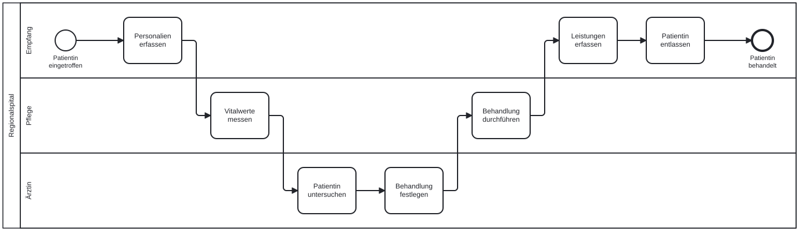

# T4-B Ambulante Behandlung im Spital

Thema 4: Kollaboration, Grundlagen | Zeit: 10 Minuten, Kernaufgabe

## Aufgabe

In der Notfallstation eines Regionalspitals trifft eine Patientin ein. Der Empfang erfasst ihre Personalien. Danach misst die Pflege die Vitalwerte. Eine Ärztin untersucht die Patientin und legt die Behandlung fest. Die Pflege führt die Behandlung durch. Zum Schluss erfasst der Empfang die erbrachten Leistungen und entlässt die Patientin. Modellieren Sie den Ablauf im Pool "Regionalspital" mit einer Lane pro Rolle.

## Lernziel

Aktivitäten den zuständigen Rollen in Lanes zuordnen.

Elemente: pool, lanes

## Musterlösung

BPMN: [solution.de.bpmn](solution.de.bpmn)

## Typische Fehler

- Für jede Rolle ein eigener Pool statt Lanes im selben Pool.
- Aktivität in der falschen Lane (z. B. Behandlung festlegen bei der Pflege).
- Lanes mit Personennamen statt Rollen beschriftet.

---
Lizenz: CC BY 4.0
