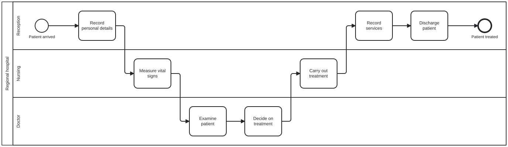

# T4-B Outpatient treatment at a hospital

Topic 4: Collaboration, Basic | Time: 10 minutes, Core exercise

## Task

A patient arrives at the emergency department of a regional hospital. Reception records her personal details. Nursing then measures her vital signs. A doctor examines the patient and decides on the treatment. Nursing carries out the treatment. Finally reception records the services provided and discharges the patient. Model the process in the pool "Regional hospital" with one lane per role.

## Learning goal

Assign activities to the responsible roles in lanes.

Elements: pool, lanes

## Sample solution

BPMN: [solution.en.bpmn](solution.en.bpmn)

## Typical mistakes

- A separate pool per role instead of lanes in one pool.
- Activity in the wrong lane (e.g. deciding the treatment in nursing).
- Lanes labelled with names of people instead of roles.

---
Licence: CC BY 4.0
