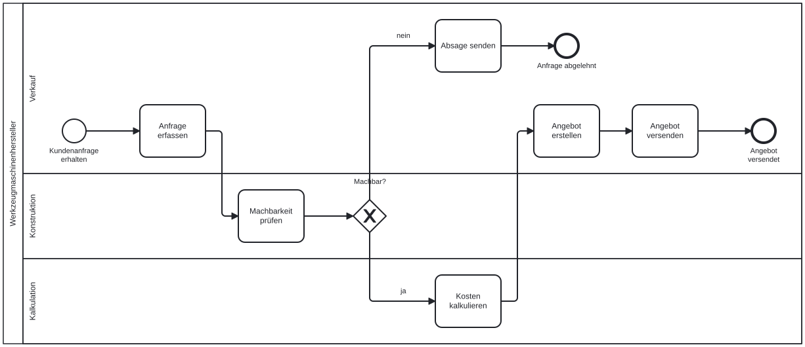

# T4-B2 Kundenanfrage beantworten

Thema 4: Kollaboration, Grundlagen | Zeit: 10 Minuten, Kernaufgabe

## Aufgabe

Ein Werkzeugmaschinenhersteller erhält eine Kundenanfrage für eine Sondermaschine. Der Verkauf erfasst die Anfrage. Die Konstruktion prüft danach die technische Machbarkeit. Ist die Maschine nicht machbar, sendet der Verkauf eine Absage und die Anfrage ist abgelehnt. Ist sie machbar, kalkuliert die Kalkulation die Kosten. Danach erstellt der Verkauf das Angebot und versendet es. Modellieren Sie den Ablauf im Pool des Herstellers mit Lanes für Verkauf, Konstruktion und Kalkulation.

## Lernziel

Lanes und eine Entscheidung kombinieren; Endzustände pro Ausgang benennen.

Elemente: pool, lanes

## Musterlösung

BPMN: [solution.de.bpmn](solution.de.bpmn)

## Typische Fehler

- Nur ein Endereignis für zwei verschiedene Ergebnisse.
- Gateway in einer anderen Lane als die Prüfung, ohne dass jemand entscheidet.
- Lanes als eigene Pools mit Nachrichtenflüssen modelliert.

---
Lizenz: CC BY 4.0
