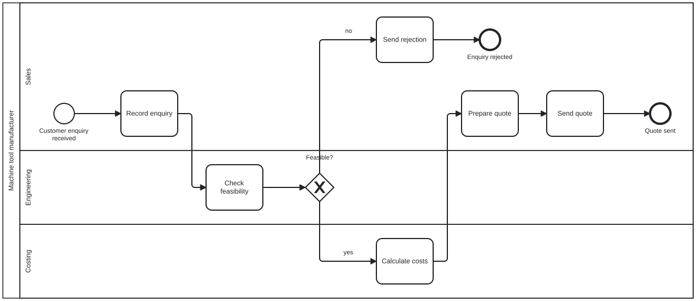

# T4-B2 Answering a customer enquiry

Topic 4: Collaboration, Basic | Time: 10 minutes, Core exercise

## Task

A machine tool manufacturer receives a customer enquiry for a custom machine. Sales records the enquiry. Engineering then checks technical feasibility. If the machine is not feasible, sales sends a rejection and the enquiry is rejected. If it is feasible, costing calculates the costs. Sales then prepares the quote and sends it. Model the process in the manufacturer's pool with lanes for sales, engineering and costing.

## Learning goal

Combine lanes with a decision; name an end state for each outcome.

Elements: pool, lanes

## Sample solution

BPMN: [solution.en.bpmn](solution.en.bpmn)

## Typical mistakes

- One end event for two different results.
- Gateway placed away from the check that decides it.
- Lanes modelled as separate pools with message flows.

---
Licence: CC BY 4.0
