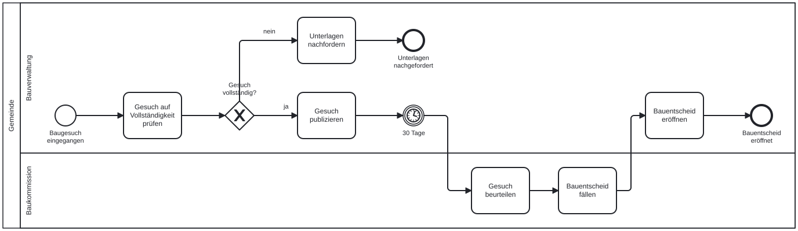

# T4-B3 Baugesuch bearbeiten

Thema 4: Kollaboration, Grundlagen | Zeit: 10 Minuten

## Aufgabe

Bei der Bauverwaltung einer Gemeinde geht ein Baugesuch ein. Die Bauverwaltung prüft das Gesuch auf Vollständigkeit. Fehlen Unterlagen, fordert sie diese bei der Bauherrschaft nach; damit endet dieser Ablauf. Ist das Gesuch vollständig, publiziert die Bauverwaltung es. Das Gesuch liegt danach in dieser Gemeinde 30 Tage öffentlich auf. Nach Ablauf der Frist beurteilt die Baukommission das Gesuch und fällt den Bauentscheid. Die Bauverwaltung eröffnet den Entscheid der Bauherrschaft. Modellieren Sie den Ablauf im Pool "Gemeinde" mit Lanes für Bauverwaltung und Baukommission.

## Lernziel

Einen Verwaltungsablauf mit zwei Rollen, einer Entscheidung und einer Frist modellieren.

Elemente: pool, lanes

## Musterlösung

BPMN: [solution.de.bpmn](solution.de.bpmn)

## Typische Fehler

- Frist als Aktivität ("30 Tage warten") statt als Zeit-Zwischenereignis.
- Bauherrschaft als Lane in der Gemeinde modelliert.
- Nein-Pfad ohne eigenes Endereignis.

---
Lizenz: CC BY 4.0
