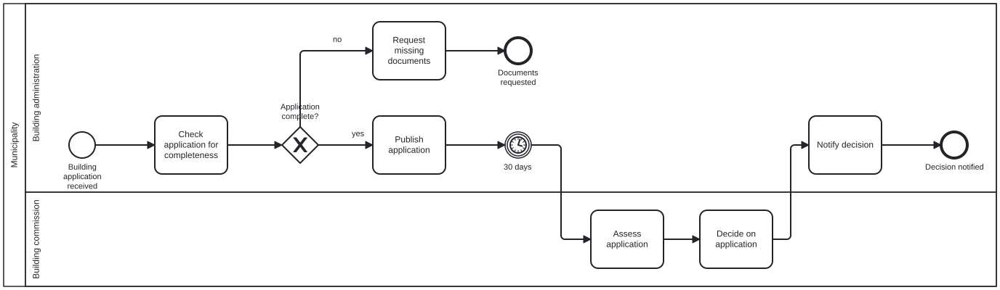

# T4-B3 Processing a building application

Topic 4: Collaboration, Basic | Time: 10 minutes

## Task

The building administration of a municipality receives a building application. The building administration checks whether the application is complete. If documents are missing, it requests them from the applicant; this ends the process. If the application is complete, the building administration publishes it. In this municipality the application is then open for public inspection for 30 days. After the deadline the building commission assesses the application and decides on it. The building administration notifies the applicant of the decision. Model the process in the pool "Municipality" with lanes for building administration and building commission.

## Learning goal

Model an administrative process with two roles, a decision and a deadline.

Elements: pool, lanes

## Sample solution

BPMN: [solution.en.bpmn](solution.en.bpmn)

## Typical mistakes

- Deadline modelled as an activity instead of a timer intermediate event.
- Applicant modelled as a lane of the municipality.
- No-path without its own end event.

---
Licence: CC BY 4.0
