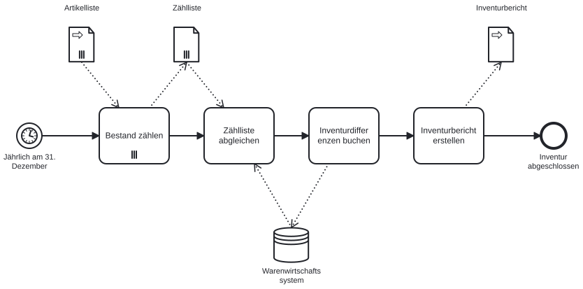

# T5-A Jahresinventur

Thema 5: Daten und Artefakte, Fortgeschritten | Zeit: 15 Minuten

## Aufgabe

Ein Hersteller von Präzisionswerkzeugen führt jedes Jahr am 31. Dezember eine Inventur durch. Der Prozess erhält als Eingabe die Artikelliste mit allen Lagerartikeln. Für jeden Artikel zählt das Lager den Bestand und trägt ihn in die Zählliste ein; die Zählungen laufen gleichzeitig. Danach gleicht die Buchhaltung die Zählliste mit dem Buchbestand im Warenwirtschaftssystem ab und bucht die Inventurdifferenzen im Warenwirtschaftssystem. Zum Schluss erstellt sie den Inventurbericht, das Ergebnis des Prozesses. Modellieren Sie den Ablauf mit Dateneingang, Datenausgang, Datensammlungen und dem Datenspeicher.

## Lernziel

Dateneingang und Datenausgang eines Prozesses sowie Datensammlungen darstellen.

Elemente: data input and output, data collection

## Musterlösung

BPMN: [solution.de.bpmn](solution.de.bpmn)

## Typische Fehler

- Artikelliste als normales Datenobjekt statt Dateneingang.
- Listen ohne Sammlungsmarker.
- Zählen als Schleife statt Mehrfachinstanz.

---
Lizenz: CC BY 4.0
