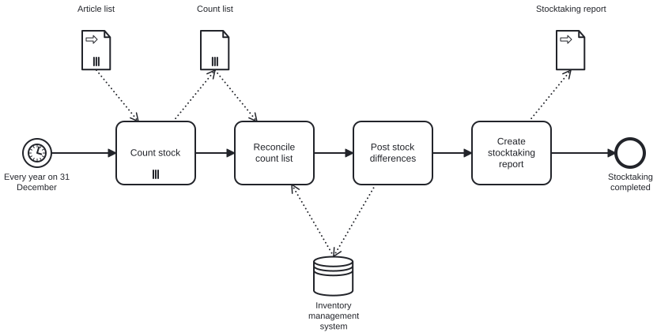

# T5-A Annual stocktaking

Topic 5: Data and artifacts, Advanced | Time: 15 minutes

## Task

A precision tool manufacturer carries out a stocktaking every year on 31 December. The process receives the article list with all stock articles as input. For each article, the warehouse counts the stock and enters it in the count list; the counts run at the same time. Accounting then reconciles the count list with the book stock in the inventory management system and posts the stock differences in the inventory management system. Finally it creates the stocktaking report, the result of the process. Model the process with data input, data output, data collections and the data store.

## Learning goal

Show the data input and output of a process and data collections.

Elements: data input and output, data collection

## Sample solution

BPMN: [solution.en.bpmn](solution.en.bpmn)

## Typical mistakes

- Article list as an ordinary data object instead of a data input.
- Lists without the collection marker.
- Counting as a loop instead of multi-instance.

---
Licence: CC BY 4.0
