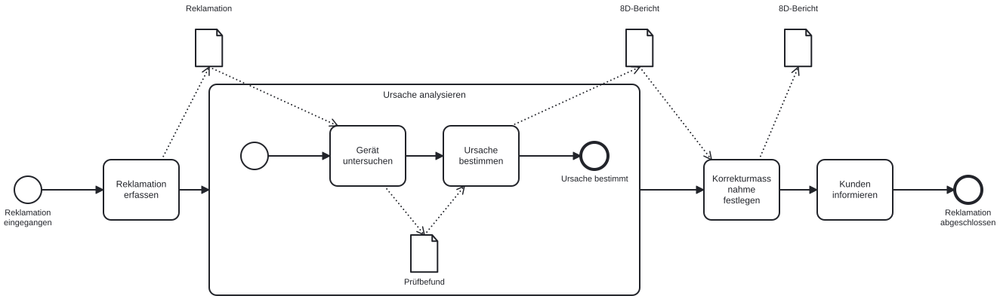

# T5-A2 Reklamation eines Medizinprodukts

Thema 5: Daten und Artefakte, Fortgeschritten | Zeit: 15 Minuten

## Aufgabe

Ein Medizintechnikhersteller bearbeitet Reklamationen zu Infusionspumpen. Geht eine Reklamation ein, erfasst der Kundendienst sie; die Reklamation ist dann erfasst. Im Teilprozess "Ursache analysieren" untersucht ein Ingenieur anhand der Reklamation das zurückgesandte Gerät und hält das Ergebnis in einem Prüfbefund fest. Mit dem Prüfbefund bestimmt er die Ursache und trägt sie in den 8D-Bericht ein. Ausserhalb des Teilprozesses legt die Qualitätssicherung anhand des 8D-Berichts die Korrekturmassnahme fest; der 8D-Bericht ist dann abgeschlossen. Zum Schluss informiert der Kundendienst den Kunden. Modellieren Sie den Ablauf mit aufgeklapptem Teilprozess und den Datenobjekten samt Zuständen.

## Lernziel

Daten in einen Teilprozess hinein und wieder heraus führen.

Elemente: data input and output, data collection

## Musterlösung

BPMN: [solution.de.bpmn](solution.de.bpmn)

## Typische Fehler

- Prüfbefund ausserhalb des Teilprozesses, obwohl er nur dort verwendet wird.
- Reklamation im Teilprozess neu erzeugt statt von aussen gelesen.
- Zustände des 8D-Berichts fehlen.

---
Lizenz: CC BY 4.0
