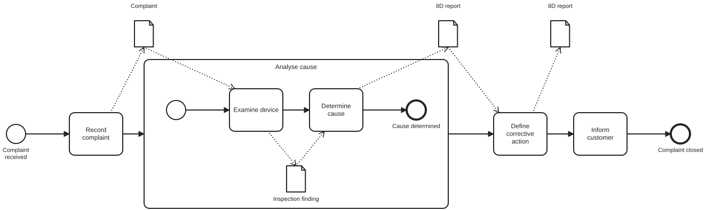

# T5-A2 Complaint about a medical device

Topic 5: Data and artifacts, Advanced | Time: 15 minutes

## Task

A medical device manufacturer handles complaints about infusion pumps. When a complaint comes in, customer service records it; the complaint is then recorded. In the subprocess "Analyse cause" an engineer examines the returned device using the complaint and documents the result in an inspection finding. Using the inspection finding he determines the cause and enters it in the 8D report. Outside the subprocess, quality assurance defines the corrective action using the 8D report; the 8D report is then completed. Finally customer service informs the customer. Model the process with an expanded subprocess and the data objects including their states.

## Learning goal

Pass data into a subprocess and out again.

Elements: data input and output, data collection

## Sample solution

BPMN: [solution.en.bpmn](solution.en.bpmn)

## Typical mistakes

- Inspection finding outside the subprocess although only used inside.
- Complaint created again inside the subprocess instead of read from outside.
- States of the 8D report missing.

---
Licence: CC BY 4.0
