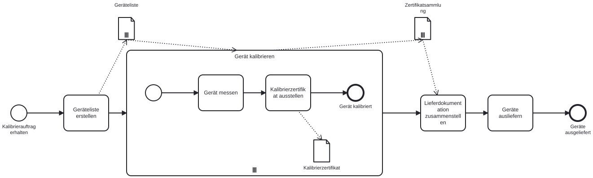

# T5-A3 Lieferung von Messgeräten kalibrieren

Thema 5: Daten und Artefakte, Fortgeschritten | Zeit: 15 Minuten

## Aufgabe

Ein Hersteller von Messgeräten kalibriert jedes Gerät vor der Auslieferung. Erhält die Kalibrierstelle einen Kalibrierauftrag, erstellt sie die Geräteliste. Für jedes Gerät auf der Liste misst ein Techniker das Gerät und stellt das Kalibrierzertifikat aus; die Geräte werden gleichzeitig an mehreren Messplätzen bearbeitet. Alle Zertifikate zusammen bilden die Zertifikatsammlung. Mit der Zertifikatsammlung stellt der Versand die Lieferdokumentation zusammen und liefert die Geräte aus. Modellieren Sie den Ablauf mit einem aufgeklappten Teilprozess.

## Lernziel

Einen Teilprozess für jedes Element einer Liste ausführen und die Ergebnisse als Sammlung weitergeben.

Elemente: data input and output, data collection

## Musterlösung

BPMN: [solution.de.bpmn](solution.de.bpmn)

## Typische Fehler

- Teilprozess ohne Mehrfachinstanz-Marker.
- Sequenzieller statt paralleler Marker, obwohl mehrere Messplätze gleichzeitig arbeiten.
- Geräteliste und Zertifikate ohne Sammlungsmarker.

---
Lizenz: CC BY 4.0
