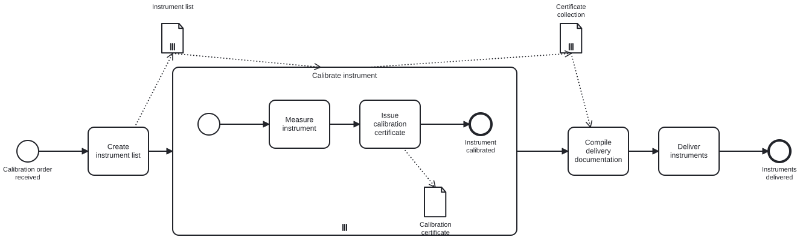

# T5-A3 Calibrating a delivery of measuring instruments

Topic 5: Data and artifacts, Advanced | Time: 15 minutes

## Task

A measuring instrument manufacturer calibrates every instrument before delivery. When the calibration lab receives a calibration order, it creates the instrument list. For each instrument on the list, a technician measures the instrument and issues the calibration certificate; the instruments are handled at the same time at several measuring stations. All certificates together form the certificate collection. Using the certificate collection, shipping compiles the delivery documentation and delivers the instruments. Model the process with an expanded subprocess.

## Learning goal

Run a subprocess for each item of a list and pass the results on as a collection.

Elements: data input and output, data collection

## Sample solution

BPMN: [solution.en.bpmn](solution.en.bpmn)

## Typical mistakes

- Subprocess without a multi-instance marker.
- Sequential instead of parallel marker although several stations work at the same time.
- Instrument list and certificates without the collection marker.

---
Licence: CC BY 4.0
