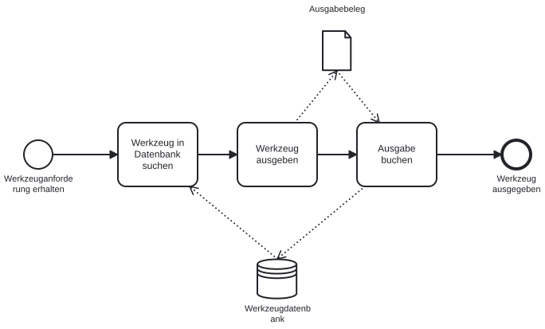

# T5-B Werkzeug ausgeben

Thema 5: Daten und Artefakte, Grundlagen | Zeit: 10 Minuten, Kernaufgabe

## Aufgabe

Im Werkzeuglager eines Zulieferbetriebs der Uhrenindustrie holen Maschinenbedienende Werkzeuge ab. Geht eine Werkzeuganforderung ein, sucht die Lagermitarbeiterin das Werkzeug in der Werkzeugdatenbank. Sie gibt das Werkzeug aus und lässt sich den Empfang auf einem Ausgabebeleg unterschreiben. Anhand des unterschriebenen Ausgabebelegs bucht sie die Ausgabe in der Werkzeugdatenbank. Modellieren Sie den Ablauf mit dem Datenspeicher und dem Datenobjekt samt Zustand.

## Lernziel

Zeigen, welche Aktivität einen Datenspeicher liest und schreibt und welche ein Dokument erzeugt.

Elemente: data object, data store, data association, data states, text annotation, group

## Musterlösung

BPMN: [solution.de.bpmn](solution.de.bpmn)

## Typische Fehler

- Datenbank als Datenobjekt statt als Datenspeicher.
- Richtung der Datenassoziation falsch (lesen statt schreiben).
- Datenobjekt mit Sequenzfluss verbunden.

---
Lizenz: CC BY 4.0
