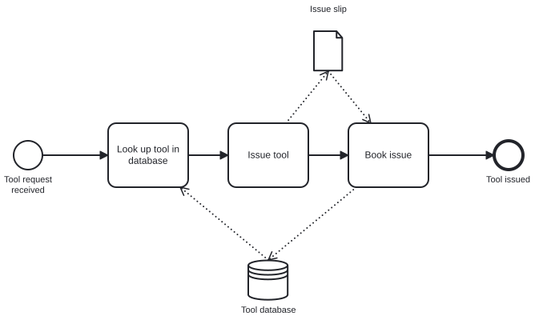

# T5-B Issuing a tool

Topic 5: Data and artifacts, Basic | Time: 10 minutes, Core exercise

## Task

In the tool store of a watch industry supplier, machine operators collect tools. When a tool request comes in, the store employee looks up the tool in the tool database. She issues the tool and has the receipt signed on an issue slip. Using the signed issue slip she books the issue in the tool database. Model the process with the data store and the data object including its state.

## Learning goal

Show which activity reads and writes a data store and which one creates a document.

Elements: data object, data store, data association, data states, text annotation, group

## Sample solution

BPMN: [solution.en.bpmn](solution.en.bpmn)

## Typical mistakes

- Database modelled as a data object instead of a data store.
- Wrong direction of the data association (read instead of write).
- Data object connected with sequence flow.

---
Licence: CC BY 4.0
