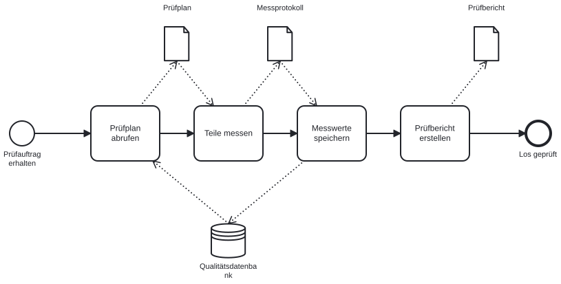

# T5-B2 Fertigungslos prüfen

Thema 5: Daten und Artefakte, Grundlagen | Zeit: 10 Minuten, Kernaufgabe

## Aufgabe

Ein Hersteller von Hydraulikzylindern prüft jedes Fertigungslos. Erhält die Qualitätssicherung einen Prüfauftrag, ruft eine Prüferin den Prüfplan aus der Qualitätsdatenbank ab und druckt ihn aus. Nach dem gedruckten Prüfplan misst sie die Teile und füllt dabei das Messprotokoll aus. Die Werte aus dem ausgefüllten Messprotokoll speichert sie in der Qualitätsdatenbank. Zum Schluss erstellt sie den Prüfbericht und gibt ihn frei. Damit ist das Los geprüft. Modellieren Sie den Ablauf mit Datenobjekten, Zuständen und dem Datenspeicher.

## Lernziel

Dokumente mit Zuständen durch den Ablauf verfolgen und Dokument von Datenbank unterscheiden.

Elemente: data object, data store, data association, data states, text annotation, group

## Musterlösung

BPMN: [solution.de.bpmn](solution.de.bpmn)

## Typische Fehler

- Zustände der Dokumente fehlen.
- Qualitätsdatenbank zweimal als getrennte Speicher modelliert, ohne dass klar ist, dass es derselbe ist.
- Lesende und schreibende Assoziation verwechselt.

---
Lizenz: CC BY 4.0
