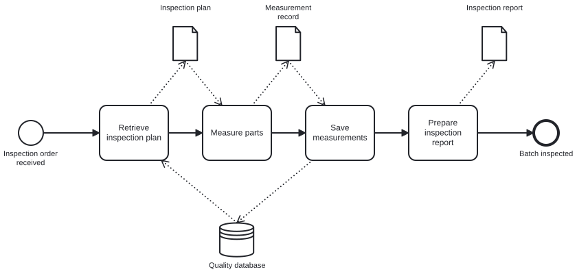

# T5-B2 Inspecting a production batch

Topic 5: Data and artifacts, Basic | Time: 10 minutes, Core exercise

## Task

A hydraulic cylinder manufacturer inspects every production batch. When quality assurance receives an inspection order, an inspector retrieves the inspection plan from the quality database and prints it. Following the printed inspection plan she measures the parts and completes the measurement record. She saves the values from the completed measurement record in the quality database. Finally she prepares the inspection report and approves it. The batch is then inspected. Model the process with data objects, states and the data store.

## Learning goal

Trace documents and their states through the process and tell a document from a database.

Elements: data object, data store, data association, data states, text annotation, group

## Sample solution

BPMN: [solution.en.bpmn](solution.en.bpmn)

## Typical mistakes

- States of the documents missing.
- Quality database drawn as two unrelated stores.
- Reading and writing associations mixed up.

---
Licence: CC BY 4.0
