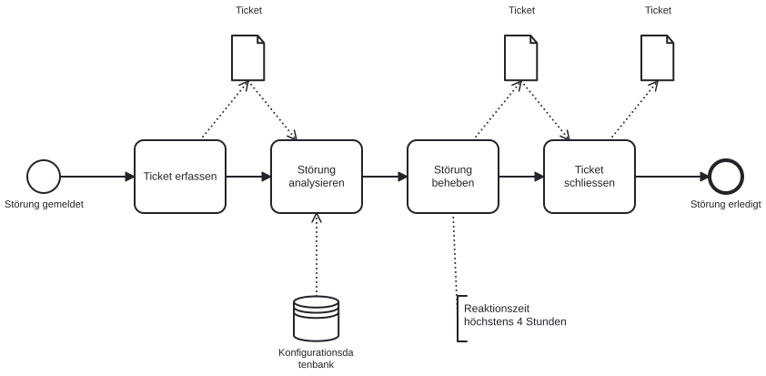

# T5-B3 Störung im IT-Servicedesk

Thema 5: Daten und Artefakte, Grundlagen | Zeit: 10 Minuten

## Aufgabe

Der IT-Servicedesk einer Regionalverwaltung bearbeitet Störungen. Meldet eine Mitarbeiterin eine Störung, erfasst der Servicedesk ein Ticket; das Ticket ist dann offen. Ein Supporter analysiert die Störung anhand des Tickets und der Konfigurationsdatenbank. Danach behebt er die Störung; das Ticket ist damit gelöst. Für das Beheben gilt eine Reaktionszeit von höchstens 4 Stunden. Zum Schluss schliesst der Servicedesk das gelöste Ticket. Modellieren Sie den Ablauf mit den Zuständen des Tickets, der Datenbank und der Vorgabe als Textanmerkung.

## Lernziel

Zustandswechsel eines Datenobjekts darstellen und eine Vorgabe als Textanmerkung ergänzen.

Elemente: data object, data store, data association, data states, text annotation, group

## Musterlösung

BPMN: [solution.de.bpmn](solution.de.bpmn)

## Typische Fehler

- Nur ein Ticket ohne Zustände modelliert.
- Reaktionszeit als Zeitereignis statt als Textanmerkung.
- Konfigurationsdatenbank als Datenobjekt modelliert.

---
Lizenz: CC BY 4.0
