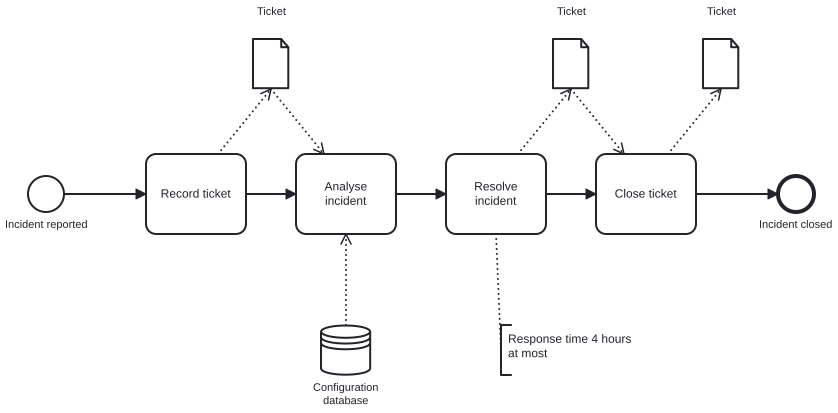

# T5-B3 Incident at an IT service desk

Topic 5: Data and artifacts, Basic | Time: 10 minutes

## Task

The IT service desk of a regional administration handles incidents. When an employee reports an incident, the service desk records a ticket; the ticket is then open. A support specialist analyses the incident using the ticket and the configuration database. He then resolves the incident; the ticket is now resolved. Resolving the incident has a response time of 4 hours at most. Finally the service desk closes the resolved ticket. Model the process with the states of the ticket, the database and the rule as a text annotation.

## Learning goal

Show state changes of a data object and add a rule as a text annotation.

Elements: data object, data store, data association, data states, text annotation, group

## Sample solution

BPMN: [solution.en.bpmn](solution.en.bpmn)

## Typical mistakes

- Only one ticket without states modelled.
- Response time modelled as a timer event instead of an annotation.
- Configuration database modelled as a data object.

---
Licence: CC BY 4.0
