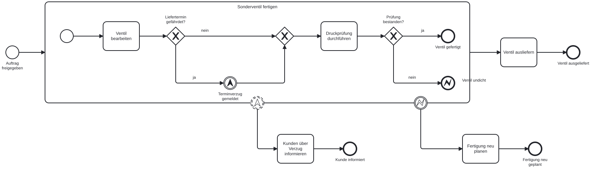

# T6-A Sonderventil fertigen

Thema 6: Ausnahmen und Kompensation, Fortgeschritten | Zeit: 15 Minuten

## Aufgabe

Ein Hersteller von Industrieventilen fertigt Sonderventile nach Kundenauftrag. Nach der Freigabe des Auftrags fertigt die Werkstatt das Ventil im Teilprozess "Sonderventil fertigen": Sie bearbeitet das Ventil. Ist danach der Liefertermin gefährdet, meldet sie den Terminverzug; die Fertigung läuft trotzdem weiter, und der Verkauf informiert den Kunden über den Verzug. Danach führt die Werkstatt die Druckprüfung durch. Ist das Ventil undicht, endet der Teilprozess mit dem Fehler "Ventil undicht", und die Arbeitsvorbereitung plant die Fertigung neu. Besteht das Ventil die Prüfung, liefert der Versand es aus. Modellieren Sie den Ablauf.

## Lernziel

Eskalation (Weiterarbeiten mit Meldung) und Fehler (Abbruch) unterscheiden.

Elemente: escalation, compensation (boundary event, compensation activity), transaction subprocess, cancel event

## Musterlösung

BPMN: [solution.de.bpmn](solution.de.bpmn)

## Typische Fehler

- Terminverzug als Fehler: die Fertigung würde abgebrochen.
- Eskalations-Randereignis unterbrechend.
- Undichtes Ventil als Eskalation: die Auslieferung würde trotzdem erfolgen.

---
Lizenz: CC BY 4.0
