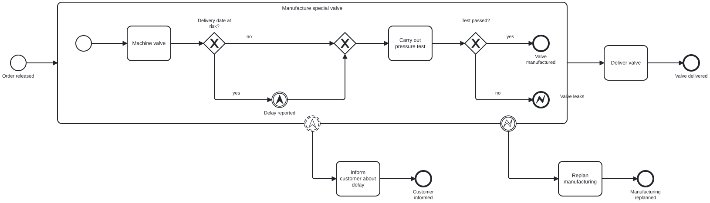

# T6-A Manufacturing a special valve

Topic 6: Exceptions and compensation, Advanced | Time: 15 minutes

## Task

An industrial valve manufacturer makes special valves to customer order. After the order has been released, the workshop manufactures the valve in the subprocess "Manufacture special valve": it machines the valve. If the delivery date is then at risk, it reports the delay; manufacturing continues anyway, and sales informs the customer about the delay. The workshop then carries out the pressure test. If the valve leaks, the subprocess ends with the error "Valve leaks", and production planning replans the manufacturing. If the valve passes the test, shipping delivers it. Model the process.

## Learning goal

Tell an escalation (continue and notify) from an error (abort).

Elements: escalation, compensation (boundary event, compensation activity), transaction subprocess, cancel event

## Sample solution

BPMN: [solution.en.bpmn](solution.en.bpmn)

## Typical mistakes

- Delay as an error: manufacturing would be aborted.
- Escalation boundary event interrupting.
- Leaking valve as an escalation: the valve would still be delivered.

---
Licence: CC BY 4.0
