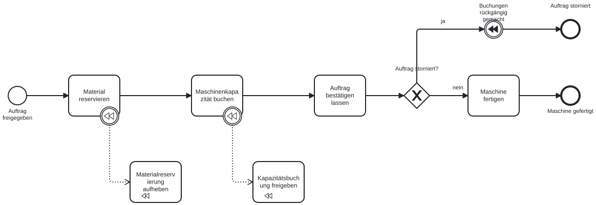

# T6-A2 Stornierten Fertigungsauftrag rückgängig machen

Thema 6: Ausnahmen und Kompensation, Fortgeschritten | Zeit: 15 Minuten

## Aufgabe

Ein Hersteller von Etikettendruckmaschinen fertigt Maschinen auf Bestellung. Nach der Auftragsfreigabe reserviert die Disposition das Material und bucht danach die Maschinenkapazität. Vor dem Fertigungsstart lässt der Verkauf den Auftrag vom Kunden bestätigen. Storniert der Kunde den Auftrag, werden alle bereits erledigten Buchungen rückgängig gemacht: Die Materialreservierung wird aufgehoben und die Kapazitätsbuchung wird freigegeben. Damit ist der Auftrag storniert. Bleibt der Auftrag bestehen, fertigt die Werkstatt die Maschine. Modellieren Sie den Ablauf mit Kompensation.

## Lernziel

Bereits erledigte Arbeit mit Kompensation rückgängig machen.

Elemente: escalation, compensation (boundary event, compensation activity), transaction subprocess, cancel event

## Musterlösung

BPMN: [solution.de.bpmn](solution.de.bpmn)

## Typische Fehler

- Rückgängigmachen als normale Aktivitäten im Hauptablauf statt Kompensation.
- Kompensationsaktivität mit Sequenzfluss angeschlossen.
- Kompensation ausgelöst, ohne dass ein Kompensations-Randereignis vorhanden ist.

---
Lizenz: CC BY 4.0
