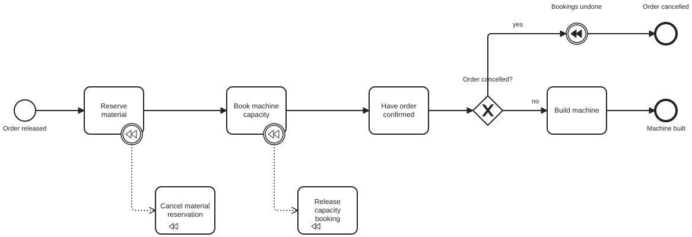

# T6-A2 Undoing a cancelled production order

Topic 6: Exceptions and compensation, Advanced | Time: 15 minutes

## Task

A label printing machine manufacturer builds machines to order. After the order has been released, material planning reserves the material and then books the machine capacity. Before production starts, sales has the customer confirm the order. If the customer cancels the order, all bookings already made are undone: the material reservation is cancelled and the capacity booking is released. The order is then cancelled. If the order stands, the workshop builds the machine. Model the process with compensation.

## Learning goal

Undo completed work with compensation.

Elements: escalation, compensation (boundary event, compensation activity), transaction subprocess, cancel event

## Sample solution

BPMN: [solution.en.bpmn](solution.en.bpmn)

## Typical mistakes

- Undoing as ordinary activities in the main flow instead of compensation.
- Compensation activity connected with sequence flow.
- Compensation thrown without any compensation boundary event.

---
Licence: CC BY 4.0
