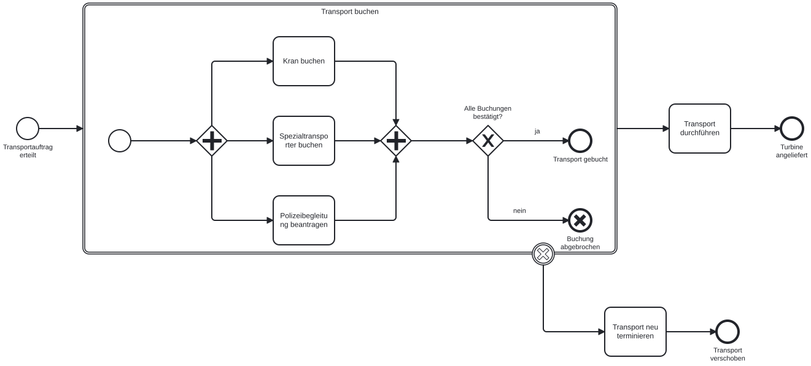

# T6-A3 Schwertransport als Transaktion buchen

Thema 6: Ausnahmen und Kompensation, Fortgeschritten | Zeit: 15 Minuten

## Aufgabe

Ein Schwerlastlogistiker transportiert eine Turbine. Ist der Transportauftrag erteilt, bucht die Disposition in einer Transaktion gleichzeitig einen Kran, einen Spezialtransporter und die Polizeibegleitung. Danach prüft sie, ob alle Buchungen bestätigt sind. Fehlt eine Bestätigung, bricht sie die Transaktion ab; alle Buchungen gelten dann als nicht erfolgt, und die Disposition terminiert den Transport neu. Sind alle Buchungen bestätigt, führt das Transportteam den Transport durch. Modellieren Sie den Ablauf mit einem Transaktions-Teilprozess.

## Lernziel

Zusammengehörige Buchungen als Transaktion modellieren, die bei einem Abbruch als Ganzes scheitert.

Elemente: escalation, compensation (boundary event, compensation activity), transaction subprocess, cancel event

## Musterlösung

BPMN: [solution.de.bpmn](solution.de.bpmn)

## Typische Fehler

- Normaler Teilprozess mit Fehler statt Transaktion mit Abbruch.
- Abbruch-Endereignis ausserhalb der Transaktion.
- Abbruch-Randereignis fehlt, der Ablauf endet ohne Neuterminierung.

---
Lizenz: CC BY 4.0
