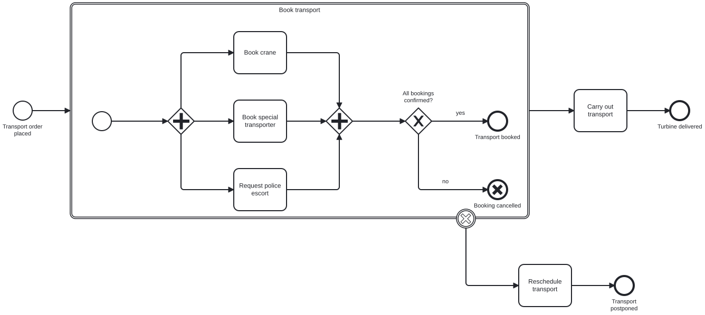

# T6-A3 Booking a heavy transport as a transaction

Topic 6: Exceptions and compensation, Advanced | Time: 15 minutes

## Task

A heavy-haul logistics company transports a turbine. Once the transport order has been placed, dispatch books a crane, a special transporter and the police escort at the same time in a transaction. It then checks whether all bookings have been confirmed. If a confirmation is missing, it cancels the transaction; all bookings are then treated as not made, and dispatch reschedules the transport. If all bookings are confirmed, the transport team carries out the transport. Model the process with a transaction subprocess.

## Learning goal

Model related bookings as a transaction that fails as a whole when cancelled.

Elements: escalation, compensation (boundary event, compensation activity), transaction subprocess, cancel event

## Sample solution

BPMN: [solution.en.bpmn](solution.en.bpmn)

## Typical mistakes

- Ordinary subprocess with an error instead of a transaction with cancel.
- Cancel end event outside the transaction.
- Cancel boundary event missing, the process ends without rescheduling.

---
Licence: CC BY 4.0
