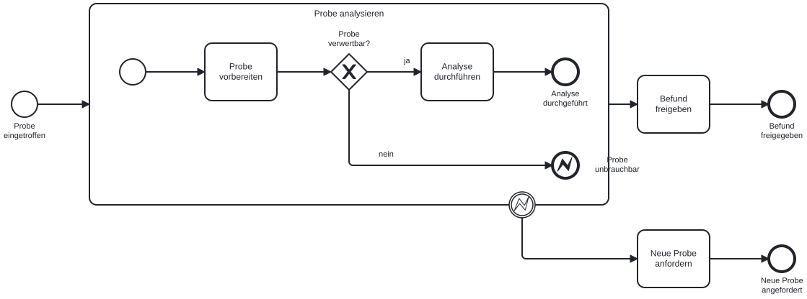

# T6-B Laborprobe analysieren

Thema 6: Ausnahmen und Kompensation, Grundlagen | Zeit: 10 Minuten, Kernaufgabe

## Aufgabe

Ein medizinisches Labor analysiert Blutproben von Arztpraxen. Trifft eine Probe ein, wird sie im Teilprozess "Probe analysieren" bearbeitet: Eine Laborantin bereitet die Probe vor und prüft, ob sie verwertbar ist. Ist sie verwertbar, führt sie die Analyse durch. Ist sie nicht verwertbar (zum Beispiel geronnen), bricht die Analyse mit dem Fehler "Probe unbrauchbar" ab. In diesem Fall fordert das Labor bei der Arztpraxis eine neue Probe an. Nach einer erfolgreichen Analyse gibt eine Ärztin den Befund frei. Modellieren Sie den Ablauf mit einem aufgeklappten Teilprozess.

## Lernziel

Einen Fehler im Teilprozess mit einem Fehler-Endereignis auslösen und am Rand des Teilprozesses abfangen.

Elemente: error end event, error boundary event

## Musterlösung

BPMN: [solution.de.bpmn](solution.de.bpmn)

## Typische Fehler

- Fehler mit einem normalen Endereignis beendet, ohne Fehler-Randereignis.
- Fehler-Randereignis an einer Aktivität ausserhalb statt am Teilprozess.
- Fehlerbehandlung über ein XOR-Gateway nach dem Teilprozess statt über das Randereignis.

---
Lizenz: CC BY 4.0
