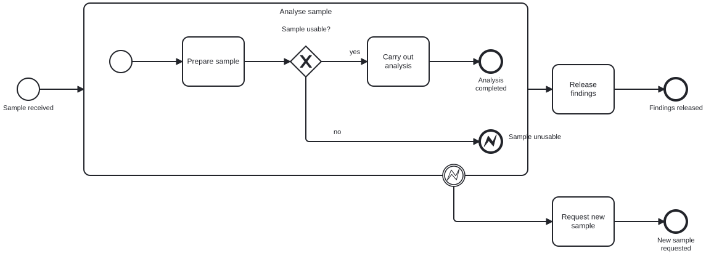

# T6-B Analysing a laboratory sample

Topic 6: Exceptions and compensation, Basic | Time: 10 minutes, Core exercise

## Task

A medical laboratory analyses blood samples from doctors' practices. When a sample arrives, it is handled in the subprocess "Analyse sample": a lab technician prepares the sample and checks whether it is usable. If it is usable, she carries out the analysis. If it is not usable (for example clotted), the analysis stops with the error "Sample unusable". In that case the laboratory requests a new sample from the practice. After a successful analysis a doctor releases the findings. Model the process with an expanded subprocess.

## Learning goal

Throw an error inside a subprocess with an error end event and catch it on the subprocess boundary.

Elements: error end event, error boundary event

## Sample solution

BPMN: [solution.en.bpmn](solution.en.bpmn)

## Typical mistakes

- Error ended with a none end event, without an error boundary event.
- Error boundary event attached to an outside activity instead of the subprocess.
- Error handled by an XOR gateway after the subprocess instead of the boundary event.

---
Licence: CC BY 4.0
