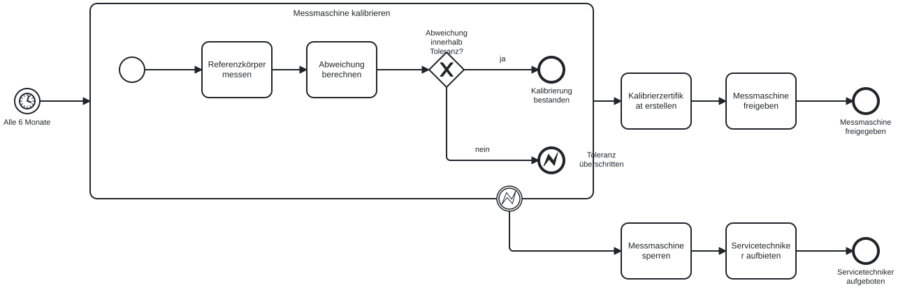

# T6-B2 Messmaschine kalibrieren

Thema 6: Ausnahmen und Kompensation, Grundlagen | Zeit: 10 Minuten, Kernaufgabe

## Aufgabe

Ein Hersteller von Präzisionsteilen kalibriert alle 6 Monate seine Koordinatenmessmaschine. Im Teilprozess "Messmaschine kalibrieren" misst ein Messtechniker einen Referenzkörper und berechnet die Abweichung. Liegt die Abweichung innerhalb der Toleranz, ist die Kalibrierung bestanden. Andernfalls endet der Teilprozess mit dem Fehler "Toleranz überschritten". Dann sperrt der Messtechniker die Maschine und bietet den Servicetechniker des Herstellers auf. Bei bestandener Kalibrierung erstellt er das Kalibrierzertifikat und gibt die Messmaschine frei. Modellieren Sie den Ablauf mit einem aufgeklappten Teilprozess.

## Lernziel

Einen Fehler bei überschrittener Toleranz auslösen und die Ausnahme ausserhalb des Teilprozesses behandeln.

Elemente: error end event, error boundary event

## Musterlösung

BPMN: [solution.de.bpmn](solution.de.bpmn)

## Typische Fehler

- Normales Startereignis statt Zeit-Startereignis "Alle 6 Monate".
- Beide Ergebnisse im Teilprozess mit normalen Endereignissen und einem XOR danach.
- Fehler-Randereignis ohne Fehlerbezeichnung.

---
Lizenz: CC BY 4.0
