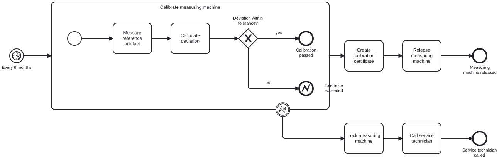

# T6-B2 Calibrating a measuring machine

Topic 6: Exceptions and compensation, Basic | Time: 10 minutes, Core exercise

## Task

A precision parts manufacturer calibrates its coordinate measuring machine every 6 months. In the subprocess "Calibrate measuring machine" a metrology technician measures a reference artefact and calculates the deviation. If the deviation is within tolerance, the calibration is passed. Otherwise the subprocess ends with the error "Tolerance exceeded". The technician then locks the machine and calls the manufacturer's service technician. If the calibration is passed, he creates the calibration certificate and releases the measuring machine. Model the process with an expanded subprocess.

## Learning goal

Throw an error when a tolerance is exceeded and handle the exception outside the subprocess.

Elements: error end event, error boundary event

## Sample solution

BPMN: [solution.en.bpmn](solution.en.bpmn)

## Typical mistakes

- None start event instead of the timer start "Every 6 months".
- Both results as none end events with an XOR after the subprocess.
- Error boundary event without an error name.

---
Licence: CC BY 4.0
