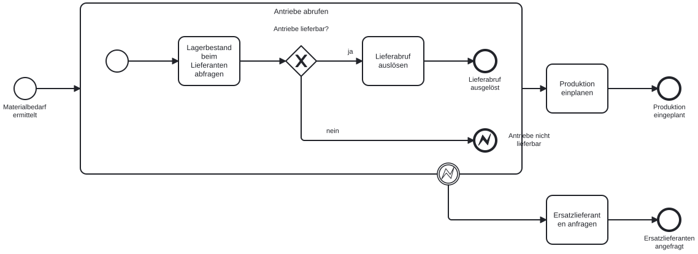

# T6-B3 Antriebe beim Lieferanten abrufen

Thema 6: Ausnahmen und Kompensation, Grundlagen | Zeit: 10 Minuten

## Aufgabe

Ein E-Bike-Hersteller bezieht Antriebseinheiten von einem Lieferanten. Sobald die Disposition den Materialbedarf ermittelt hat, ruft sie die Antriebe im Teilprozess "Antriebe abrufen" ab: Sie fragt den Lagerbestand beim Lieferanten ab. Sind die Antriebe lieferbar, löst sie den Lieferabruf aus. Sind sie nicht lieferbar, endet der Teilprozess mit dem Fehler "Antriebe nicht lieferbar"; die Disposition fragt dann Ersatzlieferanten an. Nach einem ausgelösten Lieferabruf plant die Disposition die Produktion ein. Modellieren Sie den Ablauf des E-Bike-Herstellers mit einem aufgeklappten Teilprozess.

## Lernziel

Eine Ausnahme in der Beschaffung als Fehler modellieren und einen alternativen Weg anschliessen.

Elemente: error end event, error boundary event

## Musterlösung

BPMN: [solution.de.bpmn](solution.de.bpmn)

## Typische Fehler

- Fehlerfall als zweiter Ausgang nach dem Teilprozess statt als Fehler-Randereignis.
- Fehler-Endereignis ausserhalb des Teilprozesses.
- Normaler Pfad und Fehlerpfad wieder zusammengeführt, obwohl sie verschieden enden.

---
Lizenz: CC BY 4.0
