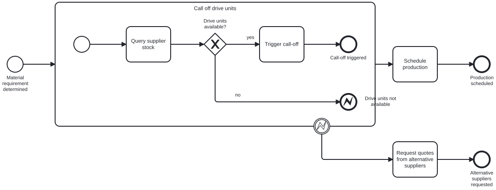

# T6-B3 Calling off drive units from a supplier

Topic 6: Exceptions and compensation, Basic | Time: 10 minutes

## Task

An e-bike manufacturer sources drive units from a supplier. As soon as material planning has determined the requirement, it calls off the drive units in the subprocess "Call off drive units": it queries the supplier's stock. If the drive units are available, it triggers the call-off. If they are not available, the subprocess ends with the error "Drive units not available"; material planning then requests quotes from alternative suppliers. After a triggered call-off, material planning schedules production. Model the e-bike manufacturer's process with an expanded subprocess.

## Learning goal

Model an exception in procurement as an error and attach an alternative path.

Elements: error end event, error boundary event

## Sample solution

BPMN: [solution.en.bpmn](solution.en.bpmn)

## Typical mistakes

- Error case as a second path after the subprocess instead of an error boundary event.
- Error end event placed outside the subprocess.
- Normal and error path merged although they end differently.

---
Licence: CC BY 4.0
